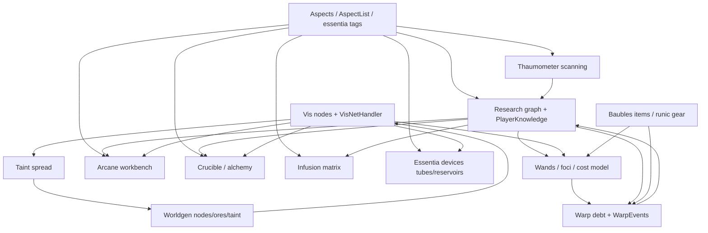

# Thaumcraft 4.2.3.5 Dependency Graph — TL-007

Static analysis of the Vineflower-decompiled sources (read-only, never
committed). Confidence: **[verified]** = read from decompiled code or
artifact metadata; **[inferred]** = deduced, not executed.

## External dependencies

### Thaumcraft → Minecraft Forge (hard) [verified]

- Declared in `@Mod`: `required-after:Forge@[10.13.2,)`.
- Used for: event buses (`MinecraftForge.EVENT_BUS`, `TERRAIN_GEN_BUS`,
  `FMLCommonHandler`), `SimpleNetworkWrapper`, `Configuration` (config
  system), `GameRegistry` (blocks/items/worldgen/fuel), `VillagerRegistry`,
  `DimensionManager` (outer realm), `EnumHelper` (tool/armor materials in
  `ThaumcraftApi`), Forge fluid `Tank`/`IFluidHandler` (crucible),
  `PlayerEvent.LoadFromFile/SaveToFile` (progression sidecar files),
  `ChunkDataEvent`, `ItemCraftedEvent`, `LivingHurtEvent`, IMC
  (`FMLInterModComms`).
- Reimplementation note: these are all 1.7.10 FML/Forge idioms; the
  NeoForge 21.1 equivalents are named in `docs/architecture/` and the RE
  policy doc — the *contracts* (event points, config categories, IMC-style
  addon hooks) are what matter, not the classes.

### Thaumcraft → Baubles (hard) [verified]

- Declared in `@Mod`: `required-after:Baubles@[1.0.1.10,)`; `mcmod.info`
  lists `dependencies: ["Baubles"]`.
- Enforced at launch by the bundled **DepLoader** coremod
  (`META-INF/MANIFEST.MF` `FMLCorePlugin: thaumcraft.codechicken.core.launch.DepLoader`):
  if the Baubles class is absent it downloads the jar from a hard-coded
  `dependancies.info` URL (Dropbox) and injects it into the mod list —
  a 1.7.10 auto-install mechanism with no modern equivalent.
- Compile-time use: 13 source files `import baubles.*` —
  `WandManager.getTotalVisDiscount` (vis discount gear in bauble slots),
  `EventHandlerRunic` (runic armor in bauble slots),
  `WarpEvents.getWarpFromGear`, `REHWandHandler`, and the six
  `common/items/baubles/*` items implementing `IBauble`.
- The slot model this version targets is Baubles 1.0.1.10's **4 slots**
  (amulet, 2 rings, belt) — see `BAUBLES_INVENTORY.md`; the modern design
  replaces the API with data attachments (`docs/architecture/ACCESSORY_SYSTEM.md`).

### Thaumcraft → CodeChicken (bundled, relocated) [verified]

- 73 classes shipped inside the jar under `thaumcraft.codechicken.*`
  (relocated, not a separate dependency): `codechicken.core.launch.DepLoader`
  (the coremod above) and `codechicken.lib` math/vec/raytracer/colour/
  render/util helpers.
- 29 source files import the relocated lib; heaviest uses:
  `lib.util.Copyable` (12), `lib.math.MathHelper` (9), `lib.vec.Vector3` (8),
  `lib.vec.Rotation/Cuboid6` (5 each), `lib.render.CCRenderState` (5),
  `lib.raytracer.RayTracer/IndexedCuboid6` (goggle target outlines),
  `lib.colour.ColourRGBA`, `lib.lighting.LightingManager`.
- Reimplementation note: these are small utility helpers; replace with
  vanilla/JOML equivalents rather than porting the library.

### Thaumcraft → optional integrations (soft) [verified]

- IMC inbound: `harvestStandardCrop/ClickableCrop/StackedCrop` (crop
  compat via `CropUtils`), `nativeCluster` (fortune clusters via
  `Utils.addSpecialMiningResult`), `lampBlacklist`, `dimensionBlacklist`,
  `biomeBlacklist`, `championWhiteList` (`ConfigEntities.championModWhitelist`).
- IMC/API outbound for addons: the whole `thaumcraft.api` package —
  recipe/aspect/research/wand registration (`ThaumcraftApi`), wand block
  triggers (`WandTriggerRegistry`), `IScanEventHandler`,
  `IInfusionStabiliser`, `IWandable`, `IVisDiscountGear`, `IRunicArmor`,
  `IWarpingGear`, `IArchitect`, `IGoggles`, `IRevealer`.
- Presence checks for other mods in `Config.initModCompatibility`
  (details not traced) **[inferred]**.

## Subsystem interdependencies

The mod is layered: everything above the aspect model consumes it.

Edge evidence (all **[verified]** from call sites):

- Aspects → everything: recipe classes carry `AspectList` costs;
  `PlayerKnowledge.aspectsDiscovered` gates research display; crucible
  matching is aspect-subset matching (`CrucibleRecipe.matches`).
- Research → crafting gates: `ShapedArcaneRecipe`/`CrucibleRecipe`/
  `InfusionRecipe` all store a research key checked through
  `ResearchManager.isResearchComplete` in `ThaumcraftCraftingManager.findMatching*`.
- Research → wands: `NODETAPPER1/2` research raises node tap rate
  (`TileNode.onUsingWandTick`).
- Vis → wands/crafting/devices: `VisNetHandler.drainVis` call sites in
  `SlotCraftingArcaneWorkbench` path (via `consumeVisFromWandCrafting`),
  `TileArcaneFurnace`, `TileAlchemyFurnaceAdvanced`, `TileArcaneBore`,
  `TileMirror`, `TileFluxScrubber`, `TileFocalManipulator`,
  `TileEssentiaCrystalizer`.
- Essentia devices → infusion: `TileInfusionMatrix` pays recipe essentia
  via `EssentiaHandler.drainEssentia(range 12)` — reservoirs/tubes feed
  the matrix; raw vis does not.
- Baubles → wands/runic/warp: `BaublesApi.getBaubles` iterated in
  `WandManager.getTotalVisDiscount`, `EventHandlerRunic`,
  `WarpEvents.getWarpFromGear`.
- Warp → research: `ThaumcraftApi.addWarpToResearch/addWarpToItem`
  registered alongside research/recipe definitions in `ConfigResearch`;
  sticky warp applied in `EventHandlerWorld.onCrafting`.
- Worldgen → vis → taint: `ThaumcraftWorldGenerator.createRandomNodeAt`
  seeds nodes; `TileNode.handleTaintNode` converts biomes and spreads
  `BlockTaintFibres`; taint biomes corrupt ordinary nodes.

**[inferred]** The one cycle worth noting: research unlocks vis tools, and
vis tools are required to pay research costs — the progression graph is
deliberately self-hosting. A reimplementation must preserve the gate
directions above or the loop breaks.

## What a port must keep vs. drop

Keep (behavioral contract): the aspect model and composition rules;
research-gated recipes; vis network drain semantics; the three crafting
stations' cost models; warp as a per-player debt; bauble slot routing.
Drop (1.7.10 idiom): DepLoader auto-install, numeric-id config classes,
username-keyed sidecar files, manual packet sync, SRG-mapped code.
